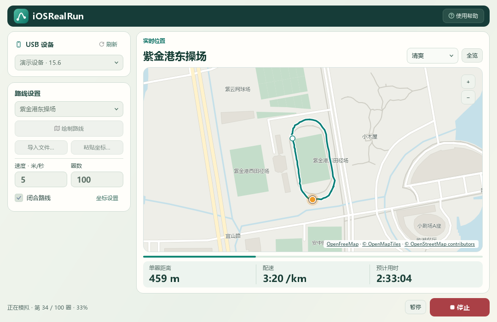

# iOSRealRun

在 iPhone 或 iPad 上按指定路线模拟定位。连接 USB、选好路线和速度，就可以开始，用于自己的设备和应用定位测试。

桌面版提供路线预览、地图选点、坐标导入、暂停和恢复定位。Windows 便携包自带 Python 和依赖。



桌面界面预览，未连接设备时也能选择路线。

## 使用方法

### 1. 下载并打开

**[下载桌面版 v0.2.0-beta.1](https://github.com/BixingWu/iOSRealRun-26/releases/tag/v0.2.0-beta.1)** · [更新说明](docs/releases/v0.2.0-beta.1.md)

这是首个桌面预发布版本。安装包自带 Python、Qt 和六条示例路线，下载后无需另装 Python。

| 平台 | 下载文件 | 打开方式 |
| --- | --- | --- |
| Windows x64 | [iOSRealRun-Windows-x64.zip](https://github.com/BixingWu/iOSRealRun-26/releases/download/v0.2.0-beta.1/iOSRealRun-Windows-x64.zip) | 完整解压，进入 `iOSRealRun` 文件夹，双击 `iOSRealRun.exe`。保留 `_internal` 文件夹。 |
| macOS 15+ · Apple Silicon | [iOSRealRun-macOS-arm64.zip](https://github.com/BixingWu/iOSRealRun-26/releases/download/v0.2.0-beta.1/iOSRealRun-macOS-arm64.zip) | 实验版。解压得到 `iOSRealRun.app`，可拖入「应用程序」。 |
| Ubuntu 22.04 / 24.04 · x64 | [iOSRealRun-Linux-x64.tar.gz](https://github.com/BixingWu/iOSRealRun-26/releases/download/v0.2.0-beta.1/iOSRealRun-Linux-x64.tar.gz) | 实验版。解压后运行 `iOSRealRun/iOSRealRun`，需要桌面环境和下方系统依赖。 |

macOS 构建暂未提供 Developer ID 签名和公证，可能受到系统拦截。请按 [Apple 的应用打开说明](https://support.apple.com/guide/mac-help/mh40616/mac)处理，或使用源码版。当前没有 Intel Mac 安装包。

Linux 初次使用可先安装设备服务和界面所需库（Ubuntu / Debian）：

```sh
sudo apt update
sudo apt install usbmuxd libxcb-cursor0 libxkbcommon-x11-0 libxcb-icccm4 libxcb-image0 libxcb-keysyms1 libxcb-render-util0 libgl1 fonts-noto-cjk
tar -xzf iOSRealRun-Linux-x64.tar.gz
./iOSRealRun/iOSRealRun
```

Linux 通过 `usbmuxd` 与 USB 设备通信，服务必须可用。macOS 使用系统自带的设备服务。更完整的环境说明见 [pymobiledevice3 安装文档](https://github.com/doronz88/pymobiledevice3/blob/v11.54.0/docs/installation.md)。

Release 同时提供 `SHA256SUMS.txt`，便于检查文件是否下载完整。Windows 可用 `Get-FileHash 文件名 -Algorithm SHA256`，macOS 用 `shasum -a 256 文件名`，Linux 用 `sha256sum 文件名`，将结果与清单对照。

[Actions](https://github.com/BixingWu/iOSRealRun-26/actions/workflows/windows-build.yml) 保留开发构建；其中的 Artifacts 下载需要登录 GitHub。**Code → Download ZIP** 下载的是源码，需按下方[源码启动](#从源码启动)步骤使用。

### 2. 连接设备

1. Windows 需要 Apple 的设备驱动。没有安装过的电脑先安装 [Apple Devices 或 iTunes](https://support.apple.com/118290)，确认它能识别设备。
2. 用支持数据传输的 USB 线连接 iPhone / iPad，解锁屏幕。
3. 程序会自动查找设备。出现「连接并信任」时点击该按钮，再在设备上确认「信任这台电脑」。
4. 在设备的 **设置 → 隐私与安全性 → 开发者模式** 中开启开关，按提示重启，解锁后再次确认。如果找不到开关，先点击程序中的「显示开发者模式开关」。
5. 等设备栏完成识别，再开始模拟。连接多台设备时，在下拉框中选定目标。

桌面版使用用户态 USB 隧道，正常运行不需要管理员权限。开发者模式仍需在设备上亲自开启。可参考 [Apple 的开发者模式说明](https://developer.apple.com/documentation/xcode/enabling-developer-mode-on-a-device)。

### 3. 选择路线并开始

- **预置路线**：直接从下拉框选择，路线文件随源码和便携包一起提供。
- **地图选点**：点击「绘制路线」，在底图上依次点击添加坐标。拖动平移，滚轮或 `+ / −` 缩放，也可以输入纬度、经度定位。至少两个点后点击「使用路线」。相邻点直接连线，不会自动沿道路规划。
- **已有路线**：点击「导入文件」加载 TXT、JSON 或 GPX，或点击「粘贴坐标」输入坐标列表。

速度单位是 **米/秒**，范围 `0.1–30`。例如 `4.4 m/s` 约为 `3:47 /km`。路线距离、配速和预计用时会随设置更新。

预置路线默认闭合。导入、粘贴和地图绘制的路线默认从起点走到终点，只运行一遍。勾选「闭合路线」后，会补上终点到起点的一段，预览以虚线表示；此时可以设定圈数，`0` 表示持续循环。

点击「开始模拟」后，蓝点显示当前进度。可以暂停、继续或停止。暂停会停留在当前模拟坐标；正常结束、停止及关闭回放窗口时，会尝试恢复设备定位。设备如果中途断开，重新连接后点击「恢复定位」，必要时重启设备。连接过程中停止时，可能需要等待约 15 秒完成服务清理。

## 兼容性

**兼容 iOS 26、27。** 通过 USB 连接设备，开启开发者模式即可使用。

| 设备系统 | 当前入口与要求 | 支持情况 |
| --- | --- | --- |
| iOS 26、27 / iPadOS 26.4 | 桌面版；已信任的 USB 连接、开发者模式 | 兼容。 |
| iOS / iPadOS 17.4–18.x | 同上，使用用户态隧道与 DVT 定位服务 | 按上游连接能力实现，尚未建立逐版本真机测试矩阵。 |
| iOS / iPadOS 17.0–17.3 | 当前版本不提供直接可用的入口 | 这些系统需要不同的隧道方式，程序会提示版本限制。 |
| iOS / iPadOS 14–16 | 保留命令行入口；需匹配的开发者磁盘镜像，16 还需开发者模式 | 兼容路径保留，本次更新未做旧设备真机回归。 |
| 低于 iOS / iPadOS 14 | 不支持 | — |

新版桌面流程不要求预先挂载开发者磁盘镜像，底层使用 `pymobiledevice3` 的 DVT 定位服务。连接机制见 [上游 DVT 文档](https://doronz88.github.io/pymobiledevice3/latest/api/dvt/)。系统升级可能改变设备服务，遇到问题请附上具体系统小版本反馈。

| 电脑环境 | 支持范围 |
| --- | --- |
| Windows 11 x64 | 当前开发和打包环境；已检查启动、界面、路线处理和便携包自检。 |
| Windows 10 x64 | 提供同一便携包，尚未单独实机验证。 |
| macOS 15+ / Apple Silicon | 提供实验性 `.app` 构建。尚未完成 Mac 上的 USB 真机回放验证。 |
| Ubuntu 22.04 / 24.04 x64 | 提供实验性便携构建；需要桌面环境、Qt 系统库与 `usbmuxd`。尚未完成 Linux 上的 USB 真机回放验证。 |
| Windows ARM、Intel Mac、其他 Linux 发行版 | 暂无专门安装包或验证，可尝试源码方式。 |

自动化测试覆盖路线解析、连接取消、定位清理、地图缓存和界面状态。

## 路线文件

| 界面名称 | 文件 | 坐标系 |
| --- | --- | --- |
| 紫金港东操场 | [ZJGEast.txt](https://github.com/BixingWu/iOSRealRun-26/blob/main/ZJGEast.txt) | BD-09 |
| 紫金港西操场 | [ZJGWest.txt](https://github.com/BixingWu/iOSRealRun-26/blob/main/ZJGWest.txt) | BD-09 |
| 玉泉操场 | [YuQuan.txt](https://github.com/BixingWu/iOSRealRun-26/blob/main/YuQuan.txt) | BD-09 |
| 玉泉操场 · YQ | [YQ.txt](https://github.com/BixingWu/iOSRealRun-26/blob/main/YQ.txt) | BD-09 |
| 西溪操场 | [XiXi.txt](https://github.com/BixingWu/iOSRealRun-26/blob/main/XiXi.txt) | BD-09 |
| 海宁操场 | [HaiNing.txt](https://github.com/BixingWu/iOSRealRun-26/blob/main/HaiNing.txt) | BD-09 |

这些是选取的示例路线，不是测绘数据。使用前请检查预览、坐标系和起终点。

JSON / TXT 推荐使用下面的格式，`lat` 是纬度，`lng` 是经度。也兼容项目原有的逗号分隔 TXT 坐标。

```json
[
  {"lat": 30.1000, "lng": 120.1000},
  {"lat": 30.1008, "lng": 120.1006},
  {"lat": 30.1012, "lng": 120.1010}
]
```

点开「坐标设置」，选择坐标来源对应的坐标系：百度为 **BD-09**，高德 / 腾讯为 **GCJ-02**，GPS 为 **WGS 84**。地图选点和 GPX 自动使用 WGS 84；手动导入 TXT / JSON 时请检查这一选择。

GPX 支持单条连续轨迹或路线，不支持直接拼接多条轨迹、多段轨迹。文件最多 2 MiB、20,000 个点；无效坐标会指出出错位置。只使用经纬度，GPX 中的时间和海拔不参与回放。

最近使用的路线、坐标系和闭合选项会保存在本机，下次打开时恢复。Windows 保存到 `%LOCALAPPDATA%\iOSRealRun\last-route.json`，macOS 保存到 `~/Library/Application Support/iOSRealRun/last-route.json`。删除该文件可回到默认路线。

地图底图来自 [OpenStreetMap](https://www.openstreetmap.org/copyright)，在线加载并缓存当前视野。底图不可用时仍可导入路线；地图窗口会显示状态并重试。项目没有地址搜索、自动道路规划或离线地图下载功能。Windows 底图缓存在 `%LOCALAPPDATA%\iOSRealRun\map-tiles.sqlite3`，macOS 在 `~/Library/Caches/iOSRealRun/`。

## 常见问题

**一直显示未连接设备**

先确认 Apple Devices / iTunes 能识别设备，再检查 USB 线是否能传输数据，解锁并确认信任，然后点击「刷新」。设备重启开启开发者模式后，也需要重新解锁。

**「开始模拟」不能点击**

检查设备栏提示、开发者模式、路线是否有效，以及速度和圈数下方的提示。未连接设备时仍可选路线、绘图和预览。

**设备显示不支持当前版本，或无法建立定位服务**

确认实际 iOS / iPadOS 小版本，并对照兼容表。17.0–17.3 不走当前桌面连接方式。其他版本先重新连接设备，检查信任和开发者模式，再重试。反馈时请保留完整错误文本。

**位置出现整体偏移**

先检查坐标系。将百度坐标当作 WGS 84 使用会产生明显偏移；导入新文件后不要沿用不匹配的选择。

**地图空白或只显示部分底图**

检查网络能否访问 OpenStreetMap。已缓存的有效区域仍可显示；未加载的区域会保留网格，稍后自动重试。选择预置路线和导入文件不依赖在线地图。

**退出后定位没有恢复**

保持设备连接，重新打开程序并点击「恢复定位」。连接已中断或设备服务无响应时，自动恢复可能失败，重启设备可作为后续处理。不要在恢复完成前拔线。

**源码启动提示 `No Python at ...`**

旧虚拟环境可能指向了已删除或移动的 Python。启动器会把失效环境备份为 `.pvenv.broken-*`，再用可用的 Python 重建。请安装 Python 3.12，必要时用 `-Python` 指定路径。

## 从源码启动

### Windows

推荐安装 64 位 [Python 3.12](https://www.python.org/downloads/)。下载或克隆仓库后，双击 `Start-iOSRealRun.bat`。首次运行会创建 `.pvenv` 并安装依赖，需要联网；之后检查环境并打开窗口。

```powershell
# 只配置环境，不打开界面
.\Start-iOSRealRun.bat -SetupOnly

# 首次创建或重建环境时指定 Python
.\Start-iOSRealRun.bat -Python "C:\path\to\python.exe"
```

启动器不会修改全局 Python，也不需要 Conda。已有的可用虚拟环境会继续使用。

### macOS / Linux

安装 Python 3.12，在项目目录运行。Linux 还需要安装上方的系统依赖：

```sh
python3.12 -m venv .venv
./.venv/bin/python -m pip install -r requirements.txt
./.venv/bin/python desktop.py
```

### 默认配置与命令行

公开默认值在 [config.yaml](https://github.com/BixingWu/iOSRealRun-26/blob/main/config.yaml)。自己的设置可写到同目录的 `config.local.yaml`，覆盖对应项；这个文件不会提交到 Git。路线已在本机保存时，桌面版优先恢复最近使用的路线。

```yaml
v: 4.4
routeConfig: "XiXi.txt"
coordinateSystem: "bd09"
updateInterval: 1.0
```

`v` 是米/秒，`updateInterval` 是秒。桌面版更新间隔范围为 `0.1–10`。便携版也可在 EXE 同目录放置 `config.yaml` 或 `config.local.yaml`；相对路线路径以配置所在目录为准，内置路线无需另行复制。

Linux 便携版的配置同样放在可执行文件旁。macOS `.app` 则读取 `~/Library/Application Support/iOSRealRun/` 中的配置，相对路线也以该目录为准，无需改动应用包。

保留的命令行入口支持 Windows / macOS，按配置持续循环。Windows 运行：

```powershell
.\Start-iOSRealRun.bat -Console
```

macOS 运行：

```sh
sudo "$PWD/.venv/bin/python" main.py
```

命令行的隧道流程需要管理员 / root 权限。iOS 14–16 会尝试自动挂载开发者磁盘镜像，首次可能需要网络；已手动挂载时，Windows 可加 `-SkipMount`，直接运行 `main.py` 时加 `--skip-mount`。按 `Ctrl+C` 结束，并等待定位清理完成。

命令行使用相同的速度和更新间隔范围。旧回放器会预先生成一圈的采样点，估算超过 125,000 个时会拒绝运行；遇到这一提示可以缩短路线、增大更新间隔，或使用桌面版。

## 开发与构建

桌面界面使用 Qt for Python（PySide6 Essentials 6.10.1），设备库基线为 `pymobiledevice3 11.54.0`。更新它时请同时验证信任、开发者模式、连接取消、暂停 / 停止和恢复定位。

```powershell
# 测试和界面自检
.\.pvenv\Scripts\python.exe -m unittest discover -s tests
.\.pvenv\Scripts\python.exe desktop.py --self-test

# 使用独立的 64 位 Python 3.12 环境打包
py -3.12 -m venv .venv-build
.\.venv-build\Scripts\python.exe -m pip install -r requirements-build.txt
.\Build-Windows.ps1 -Python .\.venv-build\Scripts\python.exe
```

macOS ARM64 和 Linux x64 使用目标平台上的 Python 3.12 构建：

```sh
python3.12 -m venv .venv-build
./.venv-build/bin/python -m pip install -r requirements-build.txt
./.venv-build/bin/python build_portable.py
```

输出在 `dist/<平台>-*/`。构建脚本会检查打包后的程序，再生成压缩包。GitHub Actions 在三种系统上运行测试和打包；发布标签时生成校验清单并创建 Release。二进制构建产物放在 Actions / Releases，仓库只保留源码、路线、文档和必要图片。

开发约定、测试和真机验证记录见 [参与开发](CONTRIBUTING.md)。

发现问题可以[提交 Issue](https://github.com/BixingWu/iOSRealRun-26/issues)，请说明电脑系统、设备型号、系统完整版本、便携版或源码版、复现步骤和错误提示。截图时请遮住设备标识和不希望公开的路线。提交修复时附上相关测试；涉及设备连接的改动，请注明是否做过真机验证。

## 来源与许可

基于 [iOSRealRun-cli-18](https://github.com/MTDickens/iOSRealRun-cli-18) 修改，桌面操作流程参考 [iOSFakeRun](https://github.com/Mythologyli/iOSFakeRun)，设备通信由 [pymobiledevice3](https://github.com/doronz88/pymobiledevice3) 提供。

项目沿用 [LICENSE](LICENSE) 中的 Mozilla Public License 2.0。便携包附带项目及依赖许可证，各依赖按其自身许可证使用。对应版本的源码和许可见 [第三方组件说明](THIRD_PARTY_NOTICES.md)。OpenStreetMap 底图保留地图署名，不随仓库分发。
