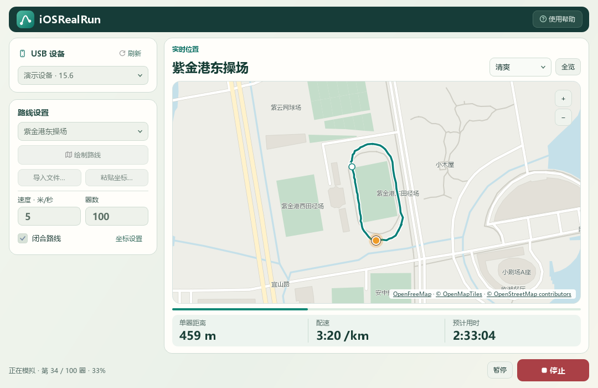

模拟时可以直接看到自己在路线上走到了哪里。主窗口用绿色线条显示路线，橙色圆点随模拟位置移动。拖动或缩放可查看周边，点击「全览」可回到整条路线。

## 地图与界面

- 在主窗口或「绘制路线」中选择「清爽」「街道」「夜色」「经典街图」或「纯轨迹」。两个窗口共用所选样式，切换底图时会保留当前路线和绘制草稿。
- 清爽、街道、夜色使用 [OpenFreeMap](https://openfreemap.org/) 的地图数据，经典街图使用 OpenStreetMap。地图署名可在画面右下角查看。选择「纯轨迹」后，绘制与回放无需加载在线底图。
- 设备和路线设置在左侧，地图下方集中显示距离、配速和预计用时。模拟和暂停状态显示在路线名上方。
- 默认速度为 5 米/秒（3:20 /km），闭合路线默认 100 圈。开放路线从起点到终点运行一次。

## 下载

| 平台 | 安装包 |
| --- | --- |
| Windows x64 | [下载 ZIP](https://github.com/BixingWu/iOSRealRun/releases/download/v0.2.0-beta.5/iOSRealRun-Windows-x64.zip) |
| macOS 15+ · Apple Silicon | [下载 ZIP](https://github.com/BixingWu/iOSRealRun/releases/download/v0.2.0-beta.5/iOSRealRun-macOS-arm64.zip) |
| Ubuntu 22.04 / 24.04 · x64 | [下载 tar.gz](https://github.com/BixingWu/iOSRealRun/releases/download/v0.2.0-beta.5/iOSRealRun-Linux-x64.tar.gz) |

完整解压后运行程序。三个安装包的哈希值见 [SHA256SUMS.txt](https://github.com/BixingWu/iOSRealRun/releases/download/v0.2.0-beta.5/SHA256SUMS.txt)。

## 兼容性与验证

三个平台均包含 iOS 14–16 的桌面 USB 连接功能。公开安装包需要用户另行提供匹配的 Apple 开发者镜像。Windows 连接 iOS 15.6 时，可将已有的镜像与签名放在程序旁的 `DeveloperDiskImage/15.6/` 目录，再连接并解锁设备。iOS / iPadOS 17.0–17.3 仍不支持。[设备与镜像说明](https://github.com/BixingWu/iOSRealRun/blob/v0.2.0-beta.5/docs/usage.md#ios-14-16-桌面连接)

已在 Windows 上用内置操场路线、在线地图和演示位置验证绘制与回放界面。Windows + iOS 15.6 的 USB 真机反馈来自上一版。macOS 和 Linux 仍为实验构建，USB 真机回放有待验证。
